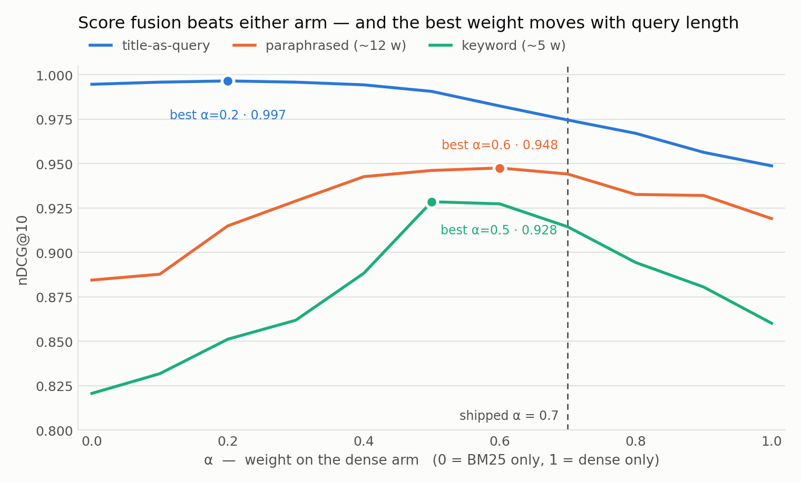
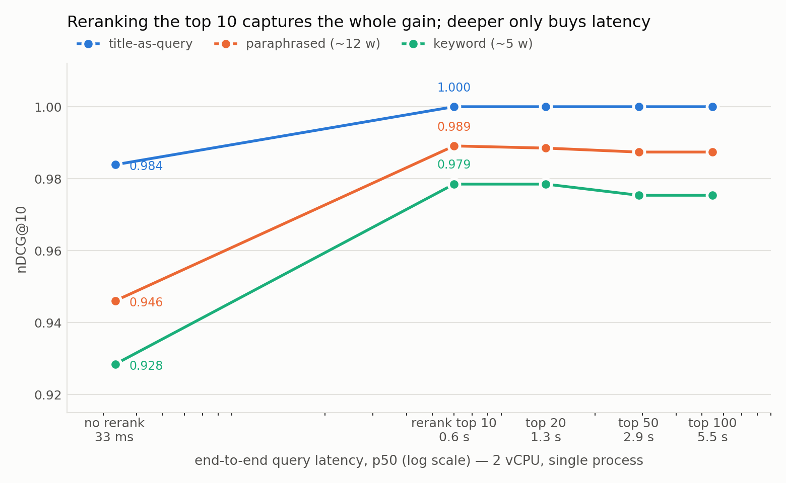
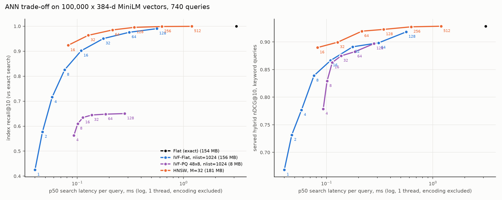
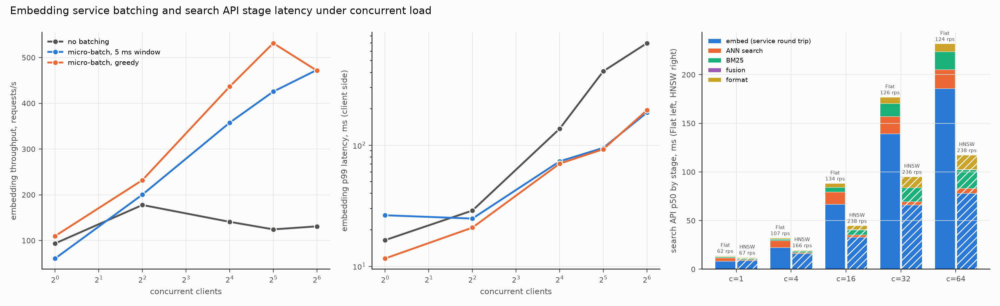

# arXiv Hybrid Semantic Search

Search ~100,000 arXiv papers with a two-arm retrieval system: a dense
Sentence-BERT index and a corpus-wide BM25 index retrieve independently, and
their ranked lists are fused. FastAPI backend, React + Vite frontend.

The interesting part of this project is not that it does hybrid retrieval — it
is that an offline evaluation harness decides *how*. The fusion strategy and its
weight were selected by measurement, and the first thing that measurement found
was a bug in the original architecture.






## Headline results

Known-item retrieval over the 100K-paper index, nDCG@10 by query type
(full method, caveats and significance tests: **[backend/eval/README.md](backend/eval/README.md)**):

| System | title queries | paraphrased | keyword (~5 words) |
|---|---|---|---|
| BM25 only (corpus-wide) | 0.995 | 0.884 | 0.821 |
| Dense only (MiniLM + FAISS) | 0.949 | 0.919 | 0.860 |
| Original hybrid (dense → BM25 rescoring, α=0.7) | 0.996 | 0.935 | 0.882 |
| **Weighted score fusion, α=0.5** ← served | 0.991 | 0.946 | **0.928** |
| + cross-encoder rerank of the top 10 (opt-in) | 1.000\* | 0.989\* | **0.978**\* |

\* Stage-2 rows are measured on 340 of the queries (the title set is
subsampled); see [backend/eval/README.md](backend/eval/README.md) section 3.

What the measurements established:

1. **Neither arm wins alone.** BM25 beats dense by 4.6 nDCG points on
   title-shaped queries and loses by 4.0 on short keyword queries. The ranking
   flips with query type, which is the empirical case for fusing them.
2. **The original "hybrid" wasn't one.** It pulled 100 candidates from FAISS and
   re-fitted BM25 *on those 100 documents* per request — estimating IDF from a
   100-document sample, and making a lexically-matching paper the embedding
   missed unreachable at any weight. Letting both arms retrieve over the full
   corpus lifted keyword-query nDCG@10 from 0.882 to 0.928 (paired bootstrap
   p = 0.014) and Recall@10 to 1.000. On 53 of 120 keyword queries, a top-10
   result now comes from a document the dense arm never returned.
3. **The hard-coded α = 0.7 was wrong for every query type.** The optimum is
   0.2 / 0.6 / 0.5 for title / paraphrased / keyword queries respectively.
4. **A cross-encoder second stage is worth +5.0 nDCG@10 — and is still off by
   default.** Reranking the top 10 takes keyword queries from 0.928 to 0.978
   (p = 0.0014), but costs 33 ms → 601 ms p50 on a 2-vCPU box. Reranking deeper
   than 10 never helped: the first stage's Recall@10 is already 1.000, so
   candidates 11-100 contain nothing left to find, and the usual "rerank the
   top 50" default would have cost 5× the latency for a slightly worse result.

5. **ANN indexes have to be tuned for recall@100, not recall@10.** Flat, IVF,
   IVF-PQ and HNSW were benchmarked on the 100K vectors with the hybrid's
   end-to-end nDCG measured for each one. HNSW (M=32, ef=256) is 5× faster than
   exact search (0.63 ms vs 3.15 ms p50, single core) for −0.1 nDCG points.
   IVF at nprobe=32 has recall@10 = 0.95 and still costs 3.7 points, because
   fusion reads the dense arm's top 100 and IVF's recall@100 is only 0.90.
   IVF-PQ fits the index in 7.6 MB (20× smaller), but its recall plateaus at
   0.65. Exact search stays the default at this corpus size; the full
   trade-off, including build, update and delete costs, is in
   [backend/eval/README.md](backend/eval/README.md) section 5.

6. **Under concurrent load, embedding is the bottleneck, and batching is the
   fix.** Query encoding now runs in a separate embedding service with
   dynamic micro-batching and an LRU cache. Every request reports embed / ANN /
   BM25 / fusion time separately. Greedy micro-batching raises embedding
   throughput 3.0× (532 vs 178 rps) and cuts p99 at 64 clients 3.6×. End to
   end, HNSW gives 1.8× the throughput of exact search (238 vs 134 rps)
   although it saves only 2.5 ms on an idle query, because exact search competes
   with the model for the same cores. With repeat traffic the cache (85 % hit
   rate) halves single-query latency to 6.3 ms. Details are in
   [backend/eval/README.md](backend/eval/README.md) section 6.

7. **Sharding without losing accuracy, and failing soft.** A 2-shard × 2-replica
   deployment (hash-sharded by arXiv id, BM25 with global statistics, exact
   top-k merge) returns the **identical top-10 for all 740 queries** as a
   single node. With a replica SIGKILLed or hung mid-load there are 0 errors and
   identical results. A half-open circuit breaker cut the hung-replica p99
   from 1,049 to 95 ms. With a whole shard down, queries return marked partial
   results at about half the nDCG instead of failing. Index versions roll out
   blue/green under traffic with 0 mixed-version responses. Design and
   measurements: [backend/distributed/README.md](backend/distributed/README.md).

BM25 was also rebuilt as a precomputed sparse weight matrix: the index went from
a 140 MB pickle to 35 MB, and corpus-wide lexical retrieval costs 0.6 ms p50
against ~30 ms for the dense arm (12.9 ms query encoding + 17.5 ms exact FAISS
search) — so the second arm is effectively free.

## Architecture

```
query
  ├─► embedding service (MiniLM, micro-batching + LRU cache) ─► FAISS Flat / HNSW ─► top 100
  └─► tokenizer ──────────────────────────────────────────────► SparseBM25        ─► top 100
                                                       │
                       min-max normalise each arm, blend α·dense + (1-α)·bm25
                                                       │
                                                  top-k results
```

```
backend/
  main.py           FastAPI app: GET /search, GET /metrics, GET /health
  embedding_service.py  standalone embedding API (POST /embed): batching, cache, metrics
  serving/          micro-batcher, embedding cache, per-stage latency recorder, embedder clients
  loadtest/         concurrent load test, ranking-parity check
  distributed/      sharded deployment: shard servers, fan-out/merge gateway, failover, versioning
  search.py         the served retrieval path
  ann_index.py      Flat / IVF / IVF-PQ / HNSW vector indexes: build, tune, update, delete
  build_ann_index.py  builds an approximate index from the exact one
  fusion.py         score fusion — imported by both the API and the harness
  bm25_index.py     corpus-wide BM25 over a precomputed sparse weight matrix
  tokenizer.py      tokenisation shared by indexing and querying
  ingest.py         one-time build: sample → encode → FAISS + BM25 + metadata
  eval/             evaluation harness, query sets, ablation results
frontend/           React + Vite search UI
```

`fusion.py` is deliberately dependency-free and side-effect-free: `search.py`
loads ~200 MB of artifacts at import time, so the ranking math lives where it
can be unit-tested — and where the served code and the measured code are the
same function rather than two copies that drift. Running the evaluation metrics
through the production `hybrid_search()` reproduces the ablation to four decimal
places on all three query sets.

## Running it

Requires the [arXiv metadata snapshot](https://www.kaggle.com/datasets/Cornell-University/arxiv)
at `data/arxiv-metadata-oai-snapshot.json`.

```bash
# backend
python -m venv venv && source venv/bin/activate
pip install -r backend/requirements.txt

cd backend
python ingest.py                 # builds index/ (FAISS + BM25 + metadata); ~30 min for 100K
uvicorn main:app --reload        # http://localhost:8000  (in-process embedding model)

# or: embedding in its own process, HNSW for concurrent load (eval/README.md 6.2)
python build_ann_index.py --kind hnsw
uvicorn embedding_service:app --port 8001
EMBEDDING_URL=http://127.0.0.1:8001 VECTOR_INDEX=hnsw uvicorn main:app --port 8000

# frontend
cd frontend && npm install && npm run dev    # http://localhost:5173
```

Retrieval is configured by environment variable, so α can be re-tuned without a
code change:

| Variable | Default | Meaning |
|---|---|---|
| `HYBRID_ALPHA` | `0.5` | weight on the dense arm (0 = BM25 only, 1 = dense only) |
| `CANDIDATES_PER_ARM` | `100` | documents each arm contributes to the fusion |
| `RERANK_TOP_K` | `0` | cross-encoder rerank depth; `0` disables stage 2, `10` is the measured optimum |
| `RERANK_MODEL` | `cross-encoder/ms-marco-MiniLM-L-6-v2` | reranker, loaded only when `RERANK_TOP_K > 0` |
| `VECTOR_INDEX` | `flat` | `flat` (exact), `hnsw`, `ivf` or `ivfpq`; build with `python build_ann_index.py --kind hnsw` |
| `HNSW_EF_SEARCH` | `256` | HNSW beam width; 256 is within 0.1 nDCG of exact, 512 matches it |
| `IVF_NPROBE` | `128` | IVF lists probed per query (of 1024) |
| `EMBEDDING_URL` | unset | use the embedding service at this URL; unset = in-process model |
| `EMBED_CACHE_SIZE` | `10000` | LRU query-embedding cache entries (in-process or service); `0` disables |
| `EMBED_BATCHING` / `EMBED_MAX_BATCH` / `EMBED_MAX_WAIT_MS` | `1` / `32` / `0` | embedding service micro-batching; wait 0 = greedy (measured best) |
| `FAISS_THREADS` | `1` | FAISS threads per search; 1 avoids oversubscription under concurrent requests |
| `MODEL_NAME` | `all-MiniLM-L6-v2` | sentence-transformers model |
| `INDEX_DIR` | `backend/index` | where the artifacts live |

## Evaluation

```bash
cd backend/eval
pip install -r requirements-eval.txt
python build_index.py                                  # BM25 indexes -> ../index/
python build_queries.py --metadata ../index/metadata.parquet
python run_eval.py                                     # stage 1 -> results/ablation.json
python run_rerank_eval.py                              # stage 2 -> results/rerank.json
python run_ann_bench.py                                # vector indexes -> results/ann_bench.json
python -m pytest test_eval.py test_ann.py test_serving.py test_distributed.py -q   # 46 tests
cd .. && python loadtest/run_load.py                   # concurrent load -> eval/results/load_test.json
python -m distributed.run_cluster_demo                 # 2 shards x 2 replicas -> eval/results/cluster.json
```

The harness scores BM25, dense, the original hybrid, weighted fusion across an
α sweep, and RRF on three query sets, then sweeps cross-encoder rerank depth
over the winning first stage — reporting Recall@10/@100, MRR@10, nDCG@10,
latency percentiles and paired-bootstrap significance throughout.

## Sharded deployment

```bash
cd backend
python -m distributed.build_shards --version v1 --shards 2       # -> index/shards/v1/
uvicorn embedding_service:app --port 8001
SHARD_ID=0 uvicorn distributed.shard_server:app --port 9100       # repeat per shard / replica
SHARD_ID=1 uvicorn distributed.shard_server:app --port 9101
EMBEDDING_URL=http://127.0.0.1:8001 uvicorn distributed.gateway:app --port 8100
```

The shard map lives in `distributed/cluster.example.json` (`CLUSTER_CONFIG`).
`GET /cluster` shows each replica's breaker state, and
`POST /admin/version` switches index versions once every shard has one.

## Known limitations

* Evaluation is **single-positive known-item retrieval**: absolute scores are
  optimistic and are not comparable to BEIR numbers. Only the relative
  comparison between systems is claimed.
* The default dense index is still `IndexFlatIP` (exact). At 100K documents it
  costs 3.15 ms per query on one core, which is less than query encoding. Its
  cost is linear in N, so at the full 2.7M corpus (4.1 GB of float32 vectors)
  HNSW or IVF-PQ is required. The ANN numbers are measured at 100K only; the
  full-corpus figures are extrapolated.
* The cross-encoder verdict is hardware-bound, not model-bound: at ~19 pairs/s
  on two CPU cores the second stage is too slow to leave on; on a GPU or with a
  quantised runtime the same gain would cost tens of milliseconds. Only
  `ms-marco-MiniLM-L-6-v2` was measured.
* No metadata filtering (category, year) in the query path yet.

## Troubleshooting

**macOS: two OpenMP runtimes.** The `faiss-cpu` and `torch` wheels each bundle
their own `libomp.dylib`. With faiss 1.16 / torch 2.15, a process that loads both
(the search API, the ANN benchmark) can segfault silently in its first parallel
region. Point faiss at torch's copy so only one runtime is loaded:

```bash
SP=$(python -c "import site; print(site.getsitepackages()[0])")
mv $SP/faiss/.dylibs/libomp.dylib $SP/faiss/.dylibs/libomp.dylib.orig
ln -s $SP/torch/lib/libomp.dylib $SP/faiss/.dylibs/libomp.dylib
```

## API

```
GET /search?q=<query>&top_k=<1-50>
```

```json
{
  "query": "graph neural network dislocation dynamics",
  "total_results": 10,
  "results": [
    {
      "arxiv_id": "2208.03296",
      "title": "Accelerating discrete dislocation dynamics simulations with graph neural networks",
      "abstract_snippet": "...",
      "authors": "...", "year": "2023", "categories": "cond-mat.mtrl-sci",
      "score": 1.0, "vector_score": 1.0, "bm25_score": 1.0,
      "retrieved_by": "both"
    }
  ],
  "timings": {"embed_ms": 8.4, "ann_ms": 3.5, "bm25_ms": 1.0, "fusion_ms": 0.17,
              "format_ms": 0.9, "total_ms": 14.1, "embed_cache_hit": 0.0}
}
```

The same per-stage timings go out as a `Server-Timing` header, and
`GET /metrics` returns rolling P50/P95/P99 per stage plus the embedding cache
hit rate.

`retrieved_by` reports which arm surfaced the document (`both` / `dense` / `bm25`).
