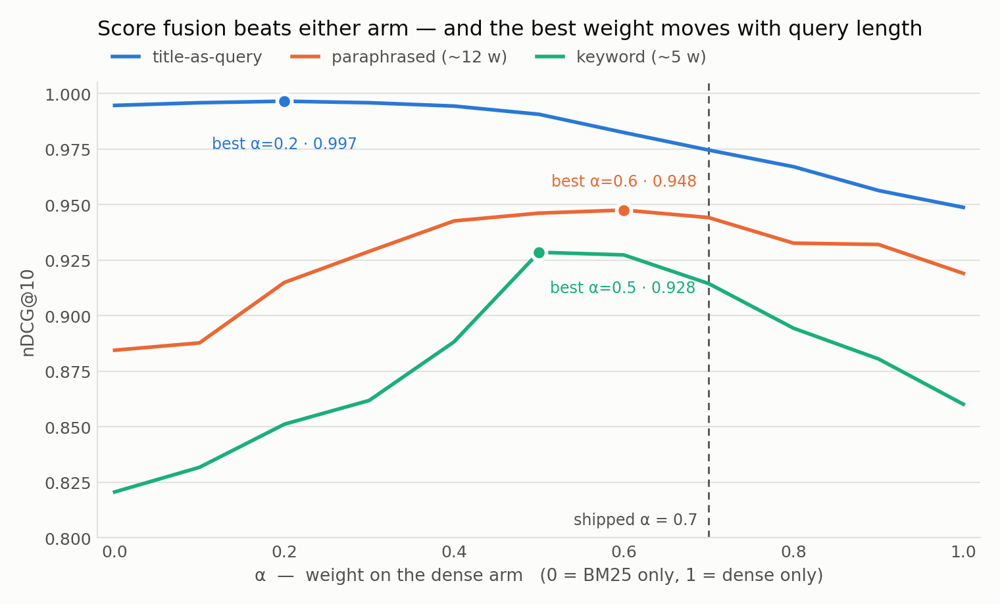
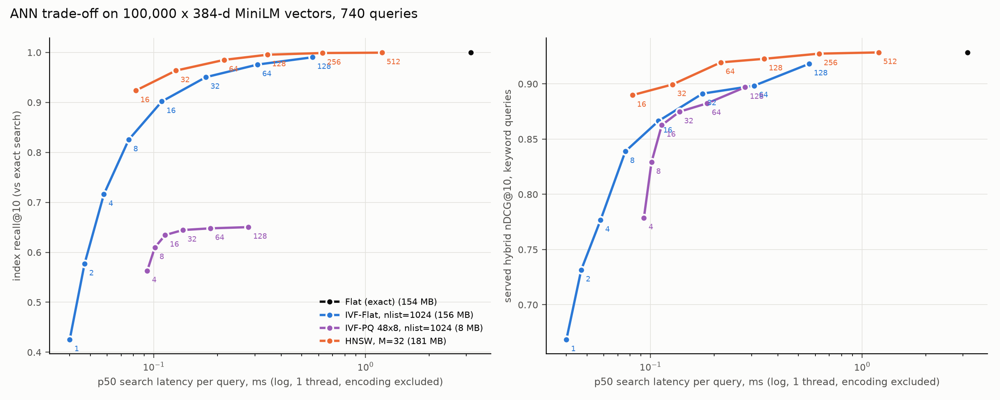

# Retrieval evaluation & fusion ablation

An offline harness that scores every retrieval strategy in this project on the
same query sets, so ranking changes are decided by measurement instead of taste.
The configuration it selected is the one `backend/search.py` now serves.

```bash
cd backend/eval
pip install -r requirements-eval.txt

python build_index.py                 # corpus-wide BM25 indexes -> ../index/
python build_queries.py --metadata ../index/metadata.parquet
python run_eval.py                    # stage 1 -> results/ablation.json
python plot_ablation.py               # -> results/alpha_sweep.png
python run_rerank_eval.py             # stage 2 -> results/rerank.json
python plot_rerank.py                 # -> results/rerank_frontier.png
python run_ann_bench.py               # vector index benchmark -> results/ann_bench.json
python plot_ann.py                    # -> results/ann_frontier.png
python -m pytest test_eval.py test_ann.py -q
```

The harness imports `fusion.py`, `bm25_index.py` and `tokenizer.py` from
`backend/` rather than copying them, so the code being measured is the code
being served.

---

## 1. What the evaluation measures

There are no relevance judgements for a private 100K-paper arXiv sample, so the
harness uses **known-item retrieval**: each query is written from one paper, and
that paper is the only judged-relevant document among 100,000. Three query sets
span the query-length spectrum, because difficulty turns out to depend on it far
more than on anything else:

| Set | n | Mean length | Query terms present in the target doc | Built by |
|---|---|---|---|---|
| `title` | 500 | 10.1 w | 100 % | the paper's own title, sampled programmatically |
| `nl` (paraphrased) | 120 | 11.8 w | 79 % | LLM-authored from the abstract, title wording deliberately avoided |
| `short` (keyword) | 120 | 4.7 w | 90 % | LLM-authored 3–6 word queries, i.e. what users actually type |

`title` is the leaky, lexical end of the distribution (every query term occurs
verbatim in the indexed text) and is biased in BM25's favour by construction.
`short` is the discriminative end: few terms means many plausible matches.

**Limitations, stated up front.** One positive per query understates real
relevance, so absolute scores are optimistic and are *not* comparable to BEIR
numbers; known-item retrieval is an easier task than ad-hoc retrieval. Relative
comparison between systems on identical queries — the only thing the ablation
claims — is unaffected. Reported significance is a paired bootstrap
(Koehn 2004, 10k resamples) over per-query nDCG@10.

## 2. Results

nDCG@10 unless noted. Latency is single-process on a 2-vCPU container, 360
uncached queries per system: read the ratio between rows, not the absolute
number.

| System | title | paraphrased | keyword | keyword R@10 | keyword MRR@10 | p50 | p95 |
|---|---|---|---|---|---|---|---|
| BM25 (legacy tokenizer, global) | 0.997 | 0.866 | 0.788 | 0.908 | 0.751 | — | — |
| BM25 (standard tokenizer, global) | 0.995 | 0.884 | 0.821 | 0.925 | 0.788 | 0.2 ms | 0.4 ms |
| Dense (MiniLM + FAISS) | 0.949 | 0.919 | 0.860 | 0.967 | 0.825 | 36.3 ms | 43.4 ms |
| **Hybrid as shipped** (dense → BM25 rescoring, α=0.7) | 0.996 | 0.935 | 0.882 | 0.967 | 0.854 | 37.4 ms | 42.1 ms |
| **Weighted fusion, α=0.5**  ← now served | 0.991 | 0.946 | **0.928** | **1.000** | **0.905** | 36.1 ms | 40.2 ms |
| Weighted fusion, α=0.6 | 0.982 | **0.948** | 0.927 | 0.992 | 0.906 | — | — |
| RRF (k=10) | 0.984 | 0.932 | 0.894 | 1.000 | 0.860 | — | — |
| RRF (k=60) | 0.982 | 0.926 | 0.873 | 0.975 | 0.839 | 36.5 ms | 40.1 ms |



### 2.1 No single signal wins

BM25 beats the dense retriever by **4.6 nDCG points** on `title` and loses to it
by **4.0** on `short`. The ranking of the two arms flips with query type, which
is the empirical case for combining them rather than an assumption about it.

### 2.2 The shipped hybrid was not a hybrid

The previous `search.py` retrieved 100 candidates from FAISS and then re-fitted
`BM25Okapi` **on those 100 documents** for every request. Two consequences the
evaluation makes visible:

* IDF was estimated from a 100-document sample instead of the corpus, so the
  term weights were unstable from query to query;
* BM25 could only *re-score* what the dense arm had already found. A document
  matched lexically but missed by the embedding was unreachable at any α.

Letting BM25 retrieve independently over the whole corpus and fusing the two
ranked lists lifts keyword-query nDCG@10 from **0.882 → 0.928** (+4.6 points,
+5.2 % relative; paired bootstrap p = 0.014) and takes Recall@10 to 1.000. On
paraphrased queries the gain is real but not significant at n=120
(0.935 → 0.948, p = 0.136); on `title` the task is saturated and the two are
indistinguishable (p = 0.373).

Against the single-signal baselines on keyword queries, fused retrieval is
significant against both: vs dense p = 0.0009, vs BM25 p = 0.0001.

The concrete effect: on **53 of the 120** keyword queries, at least one top-10
result comes from a document the dense arm never retrieved — results the old
architecture could not return at any weight.

### 2.3 α = 0.7 was the wrong constant

The shipped weight was never tuned. The sweep puts the optimum at **α ≈ 0.5**
for keyword queries and **0.6** for paraphrased ones — and at **0.2** for
title-shaped queries, where lexical evidence should dominate. No constant is
right for all three, which is the argument for either fixing α from the query
mix you actually serve, or routing on query length.

RRF is *not* the winner here. It is normalisation-free and needs no tuning,
which is why it is the usual default, but on these query sets tuned score
fusion beats it by 2–3 nDCG points (0.928 vs 0.894), so the tuning is worth its
cost.

### 2.4 The BM25 index got smaller and faster

BM25 weights do not depend on the query, so the whole saturated weight matrix is
precomputed at build time and a query becomes a sum of sparse columns
(`bm25_index.py`). Replacing the pickled token list with this:

| | Old (`bm25_corpus.pkl` + per-request `BM25Okapi`) | New (`SparseBM25`) |
|---|---|---|
| On-disk size | 140 MB | 35 MB |
| Corpus-wide BM25 query | not possible (candidates only) | 0.2 ms p50 |
| Build time (100K docs) | — | ~20 s |

Retrieval latency is dominated by query *encoding*, not search: the dense arm is
36.3 ms p50 while corpus-wide BM25 costs 0.24 ms — about 150× cheaper — so
adding a proper BM25 arm is free relative to the embedding forward pass. Fused
search is not slower than dense-only search.

## 3. Stage 2: does cross-encoder reranking earn its latency?

Model: `cross-encoder/ms-marco-MiniLM-L-6-v2`, re-scoring the served first
stage's candidates. 340 queries (120 paraphrased, 120 keyword, 100 title —
the title set is subsampled because it is nearly saturated; its first-stage
baseline is recomputed on the same subsample, so 0.9839 here is not comparable
to the 0.9906 in section 2).

**The ceiling first.** The first stage already puts the target in the top 10 for
**100 % of queries on all three sets** (Recall@10 = 1.000). Reranking therefore
cannot improve recall at all — it can only reorder within a list that already
contains the answer, and the most it can possibly reach is nDCG@10 = 1.000.

| Query set | first stage | + rerank top 10 | gain | share of the available headroom | p |
|---|---|---|---|---|---|
| title | 0.9839 | **1.0000** | +1.6 | 100 % | 0.061 |
| paraphrased | 0.9461 | **0.9891** | +4.3 | 80 % | 0.0025 |
| keyword | 0.9285 | **0.9785** | +5.0 | 70 % | 0.0014 |

The title-set gain is not significant at n=100 (p = 0.061) — the first stage was
already at 0.984 there, so only a handful of queries could change.


### 3.1 Depth 10 is both the best and the cheapest

| rerank depth | 0 | 10 | 20 | 50 | 100 |
|---|---|---|---|---|---|
| keyword nDCG@10 | 0.9285 | **0.9785** | 0.9785 | 0.9754 | 0.9754 |
| paraphrased nDCG@10 | 0.9461 | **0.9891** | 0.9885 | 0.9874 | 0.9874 |
| p50 latency | 33 ms | 601 ms | 1.32 s | 2.91 s | 5.47 s |

Going deeper than 10 never helped and slightly hurt, at up to 9× the latency.
That follows from the ceiling above: with Recall@10 already 1.000, candidates
ranked 11-100 contain no additional relevant document, so a deeper rerank can
only promote a distractor. The usual "rerank the top 50-100" default would have
cost 5× the latency for a *worse* result on this corpus — which is only visible
because the first stage's recall was measured first.

### 3.2 It is not shipped on by default

+5.0 nDCG@10 costs **33 ms → 601 ms p50** (p95 38 ms → 1.31 s) on a 2-vCPU CPU
box: an 18× latency increase for a result the first stage already had in its
top 10. For interactive search that is the wrong trade, so stage 2 is opt-in:

```bash
RERANK_TOP_K=10 uvicorn main:app        # off by default
```

The decision is a function of the hardware, not of the model: the cross-encoder
runs at ~19 pairs/s on these two cores, and 10 pairs is essentially all of the
601 ms. On a GPU, or with a distilled/ONNX-quantised reranker, the same +5.0
points would cost tens of milliseconds and the answer would flip. What is
recorded here is the measurement, not a verdict about cross-encoders.

`cross-encoder/ms-marco-MiniLM-L-12-v2` was **not** run. With 2.1 points of
headroom left on keyword queries and latency already the binding constraint, a
2× slower model chasing that remainder is not a trade worth measuring on this
hardware.

**Verified after wiring:** with `RERANK_TOP_K=10`, the production
`hybrid_search()` reproduces the experiment exactly (keyword 0.9785,
paraphrased 0.9891); with the default `RERANK_TOP_K=0` it reproduces the
stage-1 ablation exactly.

## 4. What ships in the API

`backend/search.py` serves exactly the configuration above: both arms retrieve
`CANDIDATES_PER_ARM` (100) documents over the full corpus, each arm's scores are
min-max normalised over its own returned list, and the two are blended with
`HYBRID_ALPHA` (0.5). Both are environment variables, so α can be re-tuned
without a code change.

The ranking logic itself lives in `backend/fusion.py`, which has no heavy
imports and is what both `search.py` and this harness call — the served ranking
and the measured ranking are the same function, not two copies of it.

Each result now also carries `retrieved_by` (`both` / `dense` / `bm25`), which
makes it visible in the API response which arm found a document.

**Verified after wiring:** running the metrics through the production
`hybrid_search()` reproduces the ablation to four decimals on all three query
sets (title 0.9906, paraphrased 0.9461, keyword 0.9285). If a refactor changes
those, the served ranking is no longer the measured one.

Two details worth not "cleaning up":

* the BM25 arm keeps zero-scoring documents in its returned list — dropping them
  would move the min-max floor and change every normalised score;
* normalisation is per returned list, not per corpus, which is why each arm's
  own top hit is always 1.0.

Stage 2 is wired the same way and defaults to off (`RERANK_TOP_K=0`); the model
is only loaded when it is enabled, so the default deployment never pays for it.

## 5. Vector index: exact vs approximate search

`run_ann_bench.py` compares FAISS **Flat** (exact), **IVF-Flat**, **IVF-PQ** and
**HNSW** on the 100,000 stored MiniLM vectors, with all 740 evaluation queries
encoded by the served model. Every row reports two kinds of quality:

* **index recall@k**: how much of the exact top-k the index returns. This
  measures the index on its own, with no relevance judgements involved;
* **task nDCG@10**: known-item quality of the *served hybrid* (dense + BM25,
  α = 0.5) when its dense arm uses this index. This is the number users see.

Latency is single-query search with one FAISS thread (the per-core cost that
matters under concurrent load), with query encoding excluded and 1,480 timed
searches per row, on an Apple M1. Memory is the resident-set increase of a
fresh process that loads only that index.

```bash
python run_ann_bench.py        # -> results/ann_bench.json   (~10 min)
python plot_ann.py             # -> results/ann_frontier.png
python -m pytest test_ann.py   # 10 index-layer tests
```



| Index | Setting | recall@10 | recall@100 | p50 | p95 | p99 | hybrid nDCG@10 title / para / keyword |
|---|---|---|---|---|---|---|---|
| **Flat** (exact) | — | 1.000 | 1.000 | 3.15 ms | 3.49 ms | 3.72 ms | **0.9906 / 0.9461 / 0.9285** |
| HNSW M=32 | ef=64 | 0.985 | 0.925 | 0.21 ms | 0.34 ms | 0.47 ms | 0.9837 / 0.9450 / 0.9195 |
| HNSW M=32 | ef=128 | 0.995 | 0.974 | 0.34 ms | 0.45 ms | 0.49 ms | 0.9867 / 0.9461 / 0.9227 |
| **HNSW M=32** | **ef=256** | 0.999 | 0.992 | 0.63 ms | 0.82 ms | 0.90 ms | 0.9891 / 0.9461 / **0.9274** |
| HNSW M=32 | ef=512 | 1.000 | 0.998 | 1.20 ms | 1.55 ms | 1.79 ms | 0.9899 / 0.9461 / **0.9285** |
| IVF-Flat 1024 | nprobe=32 | 0.951 | 0.904 | 0.18 ms | 0.21 ms | 0.27 ms | 0.9769 / 0.9414 / 0.8912 |
| IVF-Flat 1024 | nprobe=128 | 0.990 | 0.984 | 0.56 ms | 0.67 ms | 0.76 ms | 0.9874 / 0.9467 / 0.9182 |
| IVF-PQ 48×8 | nprobe=128 | 0.650 | 0.681 | 0.28 ms | 0.32 ms | 0.38 ms | 0.9862 / 0.9396 / 0.8970 |

The Flat row reproduces the section 2 ablation to four decimal places, so the
benchmark measures the served pipeline and not a copy of it.

| Index | Build (train + add) | On disk | Resident memory | Add throughput, 1k-vector batches | Delete |
|---|---|---|---|---|---|
| Flat | 0.03 s | 153.6 MB | 153.8 MB | 7.2 M vec/s | physical `remove_ids`; **renumbers later rows** |
| IVF-Flat 1024 | 2.2 s + 0.2 s | 156.0 MB | 163.3 MB | 414 k vec/s | physical, ids stable, 0.4 ms / 1k ids |
| IVF-PQ 48×8 | 4.1 s + 1.5 s | **7.6 MB** | **7.0 MB** | 64 k vec/s | physical, ids stable |
| HNSW M=32 | 19.4 s | 180.8 MB | 180.4 MB | **3.3 k vec/s** | not supported: tombstone filter at query time |

### 5.1 Tune for recall@100, not recall@10

Fusion consumes the dense arm's **top 100**, not its top 10. An index can look
almost perfect on recall@10 and still cost the hybrid noticeable quality:

* IVF at nprobe=32 has recall@10 = 0.951 but loses **3.7 nDCG points** on
  keyword queries (0.9285 → 0.8912), because its recall@100 is only 0.904;
* HNSW at ef=128 has recall@10 = 0.995 and still loses 0.6 points, because
  recall@100 is 0.974.

Two things happen when the deep tail is wrong. A relevant document ranked 30-100
by the dense arm, which fusion would have lifted using its BM25 score, never
reaches fusion. And the dense arm's min-max floor (its 100th score) moves, which
rescales every normalised dense score. The rule that follows: **efSearch / nprobe
are set from recall@k_each**, and k_each is 100 here. HNSW needs ef ≈ 2.5 × k_each
(ef=256) to get within 0.1 points of exact search, and ef = 5 × k_each (512) to
match it exactly.

### 5.2 What each index is good for

* **HNSW** is the best latency/quality trade-off: at ef=256 it is **5× faster
  than exact search** (0.63 ms vs 3.15 ms p50, p99 0.90 ms vs 3.72 ms) for −0.1
  nDCG points, and lossless at ef=512 for 2.6× faster. It pays for this in
  memory (+18 % over the raw vectors for the graph), a 19 s build that has no
  training step but is 600× slower than Flat, and **inserts at 3.3k vectors/s**,
  over 100× slower than IVF. It also cannot delete: a removed document stays in
  the graph as a routing node and is filtered out with an `IDSelector`. 1,000
  tombstones leaked **0** results and cost 12 % search time
  (0.100 → 0.112 ms per query). The filter only grows, so a high-churn corpus
  has to rebuild the graph periodically.
* **IVF-Flat** handles updates best: adds at 414k vectors/s, physical deletes
  with stable ids, and centroids trained on 90 % of the corpus still give
  0.896 recall@10 after the last 10 % is streamed in, against 0.902 for a full
  rebuild. Its recall/latency curve is below HNSW's at every point measured.
* **IVF-PQ** is the memory option: **7.6 MB, 20× smaller** than the raw
  vectors. Recall@10 plateaus at **0.65** however many lists are probed. That
  ceiling comes from quantisation error (8 dimensions per byte), not from search
  depth, so raising nprobe cannot remove it. Even so, the hybrid keeps
  0.897 / 0.986 nDCG on keyword / title queries because BM25 fills in what the
  compressed dense arm misses. It is the option for a corpus that does not fit
  in RAM, normally paired with exact re-ranking of a short list.
* **Flat** removes vectors by compacting the array, which renumbers every later
  row. Its "delete" is cheap (13 ms per 1k) but breaks the doc-id → metadata
  mapping unless ids are wrapped in an `IndexIDMap`. Passing explicit ids to
  `ann_index.build(..., ids=...)` does that wrapping.

### 5.3 What is served, and why it is still Flat

At 100K documents, exact search costs **3.15 ms of single-core time** per query
against 12.9 ms to encode the query (section 2.4).
The best ANN index saves at most ~2.5 ms per query, gives up exactness and makes
updates harder. That is not worth it at this corpus size, so Flat remains the
default. HNSW is one environment variable away:

```bash
python build_ann_index.py --kind hnsw          # -> index/faiss_hnsw.bin (~20 s)
VECTOR_INDEX=hnsw HNSW_EF_SEARCH=256 uvicorn main:app
```

The decision depends on corpus size. Flat cost is linear in N: extrapolating
the measured 3.15 ms at 100K gives roughly 85 ms of CPU per query and 4.1 GB of
vectors for the full 2.7M arXiv corpus. HNSW cost grows roughly logarithmically
with N. At that scale the switch to HNSW (or IVF-PQ when memory binds) is
required, and the efSearch rule from 5.1 carries over. These full-corpus
figures are an **extrapolation, not a measurement**.

## 6. Serving under concurrent load

Query embedding now runs in its own process, `embedding_service.py`
(`POST /embed`), with dynamic micro-batching (`serving/batcher.py`) and an LRU
embedding cache (`serving/cache.py`). The search API calls it when
`EMBEDDING_URL` is set and otherwise falls back to an in-process model. Every
search request records **per-stage timings**: `embed_ms`, `ann_ms`, `bm25_ms`,
`fusion_ms`, `format_ms` and `total_ms`. They are returned in the response body,
in a `Server-Timing` header, and as rolling P50/P95/P99 on `GET /metrics`.
Embedding cost and index-search cost are therefore always reported as
separate numbers, never folded into one end-to-end figure.

The served ranking is unchanged. `loadtest/verify_parity.py` runs all 740
queries through the production `hybrid_search()` and reproduces section 2
exactly (0.9906 / 0.9461 / 0.9285), both in-process and through the HTTP
embedding service. The service ships vectors as base64 float32, not decimal
JSON, so the vectors are bit-identical.

```bash
python loadtest/run_load.py              # -> results/load_test.json   (~10 min)
python loadtest/run_load.py --experiments search_e2e --vector-index hnsw --e2e-key search_e2e_hnsw
python loadtest/plot_load.py             # -> results/load_test.png
python -m pytest test_serving.py -q      # batcher, cache, latency recorder (11)
```

The load generator starts the services as separate processes and drives them
over real HTTP with closed-loop clients. Each client sends its next request as
soon as the previous one returns. Connections are opened in an untimed warm-up,
and above 16 connections the clients are spread over several processes. The
first version of the harness did not do this, and its c=64 results were wrong:
one asyncio/httpx process with 64 connections saturated at ~100 req/s. In that
run the client measured p50 430 ms while the server measured p50 12 ms, and the
batcher saw a mean batch of only 1.4. Four client processes × 16 connections
against the same server measured 489 req/s with a mean batch of 28. All hardware
is one 8-core Apple M1, shared by client and servers, so read the ratios between
rows rather than the absolute numbers.


### 6.1 Micro-batching: 3× throughput, 3.6× lower tail latency

Embedding service alone, cache off, 400-1,024 requests per level:

| clients | no batching | 5 ms batch window | **greedy batching** | greedy mean batch |
|---|---|---|---|---|
| 1 | 94 rps · p99 16 ms | 61 rps · p99 26 ms | **110 rps · p99 12 ms** | 1.0 |
| 4 | 178 rps · p99 29 ms | 200 rps · p99 25 ms | **232 rps · p99 21 ms** | 2.0 |
| 16 | 141 rps · p99 137 ms | 358 rps · p99 74 ms | **437 rps · p99 71 ms** | 6.8 |
| 32 | 124 rps · p99 409 ms | 426 rps · p99 95 ms | **532 rps · p99 93 ms** | 14.2 |
| 64 | 131 rps · p99 698 ms | 473 rps · p99 186 ms | **472 rps · p99 195 ms** | 31.0 |

* **Without batching, throughput falls once load rises.** It peaks at c=4
  (178 rps) and then declines. Each concurrent request runs its own forward
  pass, and every pass starts a full set of torch threads, so 16 concurrent
  calls on 8 cores oversubscribe the CPU. Server-side inference time rises from
  8 ms to 55-59 ms per query.
* **Batching turns concurrency into larger batches instead.** A batch of 31
  queries takes 64 ms of inference, about 2 ms per query against 8 ms run
  alone. Peak throughput is 3.0× higher (532 vs 178 rps) and p99 at c=64 is
  3.6× lower (195 vs 698 ms).
* **A fixed wait window hurts at low load.** A lone request waits the full
  5 ms for company that never comes, which cost 35 % of throughput at c=1
  (61 vs 94 rps). Greedy batching sets no timer: the batch is whatever queued
  up while the previous batch was running. It matches or beats the 5 ms
  window at every level measured, so it is the default (`EMBED_MAX_WAIT_MS=0`).
  At c=1 it carries no batching overhead (queue wait 0.02 ms).

### 6.2 Where the end-to-end time goes

Search API → embedding service (greedy batching, cache off), p50 per stage:

| clients | index | throughput | client p50 / p99 | embed | ANN | BM25 | fusion | format | server total |
|---|---|---|---|---|---|---|---|---|---|
| 1 | Flat | 62 rps | 16.1 / 17.9 ms | 8.4 | **3.5** | 1.0 | 0.17 | 0.9 | 14.1 |
| 1 | HNSW ef=256 | 67 rps | 14.4 / 25.2 ms | 9.1 | **1.0** | 1.0 | 0.16 | 0.9 | 12.3 |
| 16 | Flat | 134 rps | 117 / 188 ms | 67.0 | **12.3** | 4.8 | 0.25 | 4.0 | 91.6 |
| 16 | HNSW ef=256 | **238 rps** | **63 / 117 ms** | 33.1 | **2.3** | 5.3 | 0.19 | 4.0 | 47.0 |
| 64 | Flat | 124 rps | 506 / 861 ms | 186.0 | 19.3 | 18.3 | 0.31 | 8.0 | 248 |
| 64 | HNSW ef=256 | **238 rps** | **262 / 384 ms** | 78.3 | 5.1 | 19.1 | 0.23 | 14.8 | 123 |

* **Embedding dominates.** It is 60-75 % of server time at every level. Its
  cost under load is mostly CPU contention: at c=16 the embedding round trip
  is 67 ms, against 35 ms when the service runs alone at the same
  concurrency (6.1).
* **Under load, ANN choice matters more than single-query latency suggests.**
  On one idle query HNSW saves only 2.5 ms (3.5 → 1.0 ms). Under load it gives
  **1.8× the throughput** (238 vs 134 rps) and halves p50 at c=16. Exact search
  spends 3.5 ms of core time per query on the same 8 cores the model needs, so
  every flat search slows the embedding forward passes too (embed 67 → 33 ms
  at c=16). This revises section 5.3: Flat is the right default for a single
  idle query at 100K documents, and **HNSW (ef=256) is the right choice for
  concurrent serving**, for −0.1 nDCG points on keyword queries (or none at
  ef=512).
* **The gap between client and server total is time spent queueing before
  the handler runs.** At c=64 that is 262 − 123 ≈ 140 ms for HNSW. It is the
  API's worker thread pool plus the GIL: BM25 and response formatting are
  partly pure Python and grow from 1 ms to 15-19 ms under contention. The next
  step for this tier is multiple API worker processes, not a faster index.

### 6.3 The embedding cache

Query traffic repeats. With 3,000 requests drawn Zipf(s=1.1) from the 740
queries (448 distinct), the cache hit rate is **84.8 %**. A hit skips the
model entirely. End to end (HNSW, `--e2e-cache`):

| clients | cache off | cache on (Zipf traffic) |
|---|---|---|
| 1 | 67 rps · p50 14.4 ms (embed 9.1) | **107 rps · p50 6.3 ms** (embed 1.1) |
| 16 | 238 rps · p50 63 ms | **262 rps · p50 55 ms** |
| 64 | 238 rps · p50 262 ms | **319 rps · p50 194 ms** |

At low load the cache halves latency. At high load the gain is smaller (+34 %
throughput) because the bottleneck moves: with the model off the critical path,
what is left is the single API process (BM25 at 21 ms, queueing before the
handler). On the standalone embedding service, an all-hit workload tops out at
~330-510 rps with p95 near 100 ms. That ceiling is one uvicorn event loop's
HTTP handling, not the model, so a cache alone cannot push a single service
process past what batching already reaches.

The cache key collapses whitespace and nothing else. Lowercasing would be a
safe normalisation for this uncased model, but would silently change results
for a cased one.

## 7. What is not measured yet

* **Multi-process API serving and a GPU embedding service.** Section 6 runs
  one API process and one CPU embedding process on the same 8 cores; the
  queueing it found is the reason to measure both next.
* **ANN behaviour at full-corpus scale.** Section 5 measures 100K vectors;
  the 2.7M-document numbers in 5.3 are extrapolated. IVF-PQ with exact
  re-ranking of a short list is the obvious next row.
* **A larger cross-encoder**, and a GPU or quantised runtime that would change
  the section 3.2 verdict.
* **Multi-positive judgements.** Every number here is single-positive known-item
  retrieval; a set with graded, multi-document judgements would be strictly
  better and is the main threat to these conclusions.

## 8. Layout

```
backend/
  fusion.py         score fusion — shared by the API and this harness
  bm25_index.py     corpus-wide BM25 over a precomputed sparse weight matrix
  tokenizer.py      the two tokenisations compared
  search.py         the served hybrid retrieval path
  ann_index.py      Flat / IVF / IVF-PQ / HNSW: build, tune, persist, update, delete
  build_ann_index.py  builds index/faiss_<kind>.bin from the exact index
  embedding_service.py  standalone embedding API: micro-batching, cache, /metrics
  serving/          batcher.py, cache.py, latency.py (per-stage recorder), embedder.py
  loadtest/         run_load.py (concurrent load), plot_load.py, verify_parity.py
  eval/
    encoder.py      query encoder (transformers; matches the ingest embeddings exactly)
    retrievers.py   dense / BM25 / legacy hybrid / weighted fusion / RRF / cross-encoder
    metrics.py      Recall@k, MRR@k, nDCG@k
    build_index.py  builds both BM25 indexes into ../index/
    build_queries.py builds the three query sets
    run_eval.py     stage-1 ablation: quality, latency, paired bootstrap
    run_rerank_eval.py stage-2 cross-encoder reranking and depth sweep
    run_ann_bench.py   vector index benchmark (section 5)
    plot_ablation.py / plot_rerank.py / plot_ann.py  the figures
    test_eval.py    metric, BM25, fusion and rerank correctness tests (14)
    test_ann.py     index layer: exactness, nprobe/ef monotonicity, adds, deletes (10)
    test_serving.py micro-batcher, embedding cache, latency recorder (11)
    queries/        query sets (.tsv authored, .jsonl generated)
    results/        ablation.json, alpha_sweep.png
```

The encoder is verified against the index it evaluates: re-encoding a stored
document reproduces its FAISS vector to cosine 1.000, so query and document
vectors are guaranteed to come from the same model and pooling.
