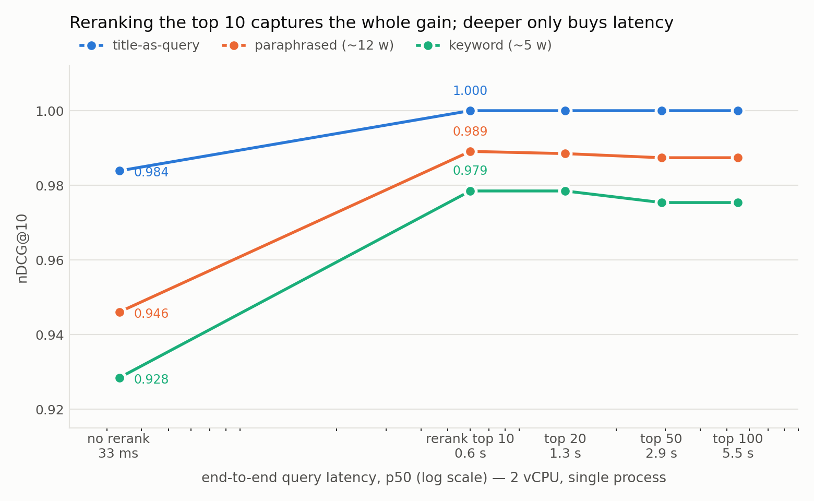

# Retrieval evaluation & fusion ablation

An offline harness that scores every retrieval strategy in this project on the
same query sets, so ranking changes are decided by measurement instead of taste.
The configuration it selected is the one `backend/search.py` now serves.

```bash
cd backend/eval
pip install -r requirements-eval.txt

python build_index.py                 # corpus-wide BM25 indexes -> ../index/
python build_queries.py --metadata ../index/metadata.parquet
python run_eval.py                    # stage 1 -> results/ablation.json
python plot_ablation.py               # -> results/alpha_sweep.png
python run_rerank_eval.py             # stage 2 -> results/rerank.json
python plot_rerank.py                 # -> results/rerank_frontier.png
python -m pytest test_eval.py -q      # 14 correctness tests
```

The harness imports `fusion.py`, `bm25_index.py` and `tokenizer.py` from
`backend/` rather than copying them, so the code being measured is the code
being served.

---

## 1. What the evaluation measures

There are no relevance judgements for a private 100K-paper arXiv sample, so the
harness uses **known-item retrieval**: each query is written from one paper, and
that paper is the only judged-relevant document among 100,000. Three query sets
span the query-length spectrum, because difficulty turns out to depend on it far
more than on anything else:

| Set | n | Mean length | Query terms present in the target doc | Built by |
|---|---|---|---|---|
| `title` | 500 | 10.1 w | 100 % | the paper's own title, sampled programmatically |
| `nl` (paraphrased) | 120 | 11.8 w | 79 % | LLM-authored from the abstract, title wording deliberately avoided |
| `short` (keyword) | 120 | 4.7 w | 90 % | LLM-authored 3–6 word queries, i.e. what users actually type |

`title` is the leaky, lexical end of the distribution (every query term occurs
verbatim in the indexed text) and is biased in BM25's favour by construction.
`short` is the discriminative end: few terms means many plausible matches.

**Limitations, stated up front.** One positive per query understates real
relevance, so absolute scores are optimistic and are *not* comparable to BEIR
numbers; known-item retrieval is an easier task than ad-hoc retrieval. Relative
comparison between systems on identical queries — the only thing the ablation
claims — is unaffected. Reported significance is a paired bootstrap
(Koehn 2004, 10k resamples) over per-query nDCG@10.

## 2. Results

nDCG@10 unless noted. Latency is single-process on a 2-vCPU container, 360
uncached queries per system: read the ratio between rows, not the absolute
number.

| System | title | paraphrased | keyword | keyword R@10 | keyword MRR@10 | p50 | p95 |
|---|---|---|---|---|---|---|---|
| BM25 (legacy tokenizer, global) | 0.997 | 0.866 | 0.788 | 0.908 | 0.751 | — | — |
| BM25 (standard tokenizer, global) | 0.995 | 0.884 | 0.821 | 0.925 | 0.788 | 0.2 ms | 0.4 ms |
| Dense (MiniLM + FAISS) | 0.949 | 0.919 | 0.860 | 0.967 | 0.825 | 36.3 ms | 43.4 ms |
| **Hybrid as shipped** (dense → BM25 rescoring, α=0.7) | 0.996 | 0.935 | 0.882 | 0.967 | 0.854 | 37.4 ms | 42.1 ms |
| **Weighted fusion, α=0.5**  ← now served | 0.991 | 0.946 | **0.928** | **1.000** | **0.905** | 36.1 ms | 40.2 ms |
| Weighted fusion, α=0.6 | 0.982 | **0.948** | 0.927 | 0.992 | 0.906 | — | — |
| RRF (k=10) | 0.984 | 0.932 | 0.894 | 1.000 | 0.860 | — | — |
| RRF (k=60) | 0.982 | 0.926 | 0.873 | 0.975 | 0.839 | 36.5 ms | 40.1 ms |


### 2.1 No single signal wins

BM25 beats the dense retriever by **4.6 nDCG points** on `title` and loses to it
by **4.0** on `short`. The ranking of the two arms flips with query type, which
is the empirical case for combining them rather than an assumption about it.

### 2.2 The shipped hybrid was not a hybrid

The previous `search.py` retrieved 100 candidates from FAISS and then re-fitted
`BM25Okapi` **on those 100 documents** for every request. Two consequences the
evaluation makes visible:

* IDF was estimated from a 100-document sample instead of the corpus, so the
  term weights were unstable from query to query;
* BM25 could only *re-score* what the dense arm had already found. A document
  matched lexically but missed by the embedding was unreachable at any α.

Letting BM25 retrieve independently over the whole corpus and fusing the two
ranked lists lifts keyword-query nDCG@10 from **0.882 → 0.928** (+4.6 points,
+5.2 % relative; paired bootstrap p = 0.014) and takes Recall@10 to 1.000. On
paraphrased queries the gain is real but not significant at n=120
(0.935 → 0.948, p = 0.136); on `title` the task is saturated and the two are
indistinguishable (p = 0.373).

Against the single-signal baselines on keyword queries, fused retrieval is
significant against both: vs dense p = 0.0009, vs BM25 p = 0.0001.

The concrete effect: on **53 of the 120** keyword queries, at least one top-10
result comes from a document the dense arm never retrieved — results the old
architecture could not return at any weight.

### 2.3 α = 0.7 was the wrong constant

The shipped weight was never tuned. The sweep puts the optimum at **α ≈ 0.5**
for keyword queries and **0.6** for paraphrased ones — and at **0.2** for
title-shaped queries, where lexical evidence should dominate. No constant is
right for all three, which is the argument for either fixing α from the query
mix you actually serve, or routing on query length.

RRF is *not* the winner here. It is normalisation-free and needs no tuning,
which is why it is the usual default, but on these query sets tuned score
fusion beats it by 2–3 nDCG points (0.928 vs 0.894), so the tuning is worth its
cost.

### 2.4 The BM25 index got smaller and faster

BM25 weights do not depend on the query, so the whole saturated weight matrix is
precomputed at build time and a query becomes a sum of sparse columns
(`bm25_index.py`). Replacing the pickled token list with this:

| | Old (`bm25_corpus.pkl` + per-request `BM25Okapi`) | New (`SparseBM25`) |
|---|---|---|
| On-disk size | 140 MB | 35 MB |
| Corpus-wide BM25 query | not possible (candidates only) | 0.2 ms p50 |
| Build time (100K docs) | — | ~20 s |

Retrieval latency is dominated by query *encoding*, not search: the dense arm is
36.3 ms p50 while corpus-wide BM25 costs 0.24 ms — about 150× cheaper — so
adding a proper BM25 arm is free relative to the embedding forward pass. Fused
search is not slower than dense-only search.

## 3. Stage 2: does cross-encoder reranking earn its latency?

Model: `cross-encoder/ms-marco-MiniLM-L-6-v2`, re-scoring the served first
stage's candidates. 340 queries (120 paraphrased, 120 keyword, 100 title —
the title set is subsampled because it is nearly saturated; its first-stage
baseline is recomputed on the same subsample, so 0.9839 here is not comparable
to the 0.9906 in section 2).

**The ceiling first.** The first stage already puts the target in the top 10 for
**100 % of queries on all three sets** (Recall@10 = 1.000). Reranking therefore
cannot improve recall at all — it can only reorder within a list that already
contains the answer, and the most it can possibly reach is nDCG@10 = 1.000.

| Query set | first stage | + rerank top 10 | gain | share of the available headroom | p |
|---|---|---|---|---|---|
| title | 0.9839 | **1.0000** | +1.6 | 100 % | 0.061 |
| paraphrased | 0.9461 | **0.9891** | +4.3 | 80 % | 0.0025 |
| keyword | 0.9285 | **0.9785** | +5.0 | 70 % | 0.0014 |

The title-set gain is not significant at n=100 (p = 0.061) — the first stage was
already at 0.984 there, so only a handful of queries could change.



### 3.1 Depth 10 is both the best and the cheapest

| rerank depth | 0 | 10 | 20 | 50 | 100 |
|---|---|---|---|---|---|
| keyword nDCG@10 | 0.9285 | **0.9785** | 0.9785 | 0.9754 | 0.9754 |
| paraphrased nDCG@10 | 0.9461 | **0.9891** | 0.9885 | 0.9874 | 0.9874 |
| p50 latency | 33 ms | 601 ms | 1.32 s | 2.91 s | 5.47 s |

Going deeper than 10 never helped and slightly hurt, at up to 9× the latency.
That follows from the ceiling above: with Recall@10 already 1.000, candidates
ranked 11-100 contain no additional relevant document, so a deeper rerank can
only promote a distractor. The usual "rerank the top 50-100" default would have
cost 5× the latency for a *worse* result on this corpus — which is only visible
because the first stage's recall was measured first.

### 3.2 It is not shipped on by default

+5.0 nDCG@10 costs **33 ms → 601 ms p50** (p95 38 ms → 1.31 s) on a 2-vCPU CPU
box: an 18× latency increase for a result the first stage already had in its
top 10. For interactive search that is the wrong trade, so stage 2 is opt-in:

```bash
RERANK_TOP_K=10 uvicorn main:app        # off by default
```

The decision is a function of the hardware, not of the model: the cross-encoder
runs at ~19 pairs/s on these two cores, and 10 pairs is essentially all of the
601 ms. On a GPU, or with a distilled/ONNX-quantised reranker, the same +5.0
points would cost tens of milliseconds and the answer would flip. What is
recorded here is the measurement, not a verdict about cross-encoders.

`cross-encoder/ms-marco-MiniLM-L-12-v2` was **not** run. With 2.1 points of
headroom left on keyword queries and latency already the binding constraint, a
2× slower model chasing that remainder is not a trade worth measuring on this
hardware.

**Verified after wiring:** with `RERANK_TOP_K=10`, the production
`hybrid_search()` reproduces the experiment exactly (keyword 0.9785,
paraphrased 0.9891); with the default `RERANK_TOP_K=0` it reproduces the
stage-1 ablation exactly.

## 4. What ships in the API

`backend/search.py` serves exactly the configuration above: both arms retrieve
`CANDIDATES_PER_ARM` (100) documents over the full corpus, each arm's scores are
min-max normalised over its own returned list, and the two are blended with
`HYBRID_ALPHA` (0.5). Both are environment variables, so α can be re-tuned
without a code change.

The ranking logic itself lives in `backend/fusion.py`, which has no heavy
imports and is what both `search.py` and this harness call — the served ranking
and the measured ranking are the same function, not two copies of it.

Each result now also carries `retrieved_by` (`both` / `dense` / `bm25`), which
makes it visible in the API response which arm found a document.

**Verified after wiring:** running the metrics through the production
`hybrid_search()` reproduces the ablation to four decimals on all three query
sets (title 0.9906, paraphrased 0.9461, keyword 0.9285). If a refactor changes
those, the served ranking is no longer the measured one.

Two details worth not "cleaning up":

* the BM25 arm keeps zero-scoring documents in its returned list — dropping them
  would move the min-max floor and change every normalised score;
* normalisation is per returned list, not per corpus, which is why each arm's
  own top hit is always 1.0.

Stage 2 is wired the same way and defaults to off (`RERANK_TOP_K=0`); the model
is only loaded when it is enabled, so the default deployment never pays for it.

## 5. What is not measured yet

* **ANN index trade-offs.** Everything above uses `IndexFlatIP`, i.e. exact
  brute-force search — already 58 % of dense-arm latency at 100K documents and
  linear in corpus size. The recall/latency curve for HNSW and IVF-PQ is the
  next measurement.
* **A larger cross-encoder**, and a GPU or quantised runtime that would change
  the section 3.2 verdict.
* **Multi-positive judgements.** Every number here is single-positive known-item
  retrieval; a set with graded, multi-document judgements would be strictly
  better and is the main threat to these conclusions.

## 6. Layout

```
backend/
  fusion.py         score fusion — shared by the API and this harness
  bm25_index.py     corpus-wide BM25 over a precomputed sparse weight matrix
  tokenizer.py      the two tokenisations compared
  search.py         the served hybrid retrieval path
  eval/
    encoder.py      query encoder (transformers; matches the ingest embeddings exactly)
    retrievers.py   dense / BM25 / legacy hybrid / weighted fusion / RRF / cross-encoder
    metrics.py      Recall@k, MRR@k, nDCG@k
    build_index.py  builds both BM25 indexes into ../index/
    build_queries.py builds the three query sets
    run_eval.py     stage-1 ablation: quality, latency, paired bootstrap
    run_rerank_eval.py stage-2 cross-encoder reranking and depth sweep
    plot_ablation.py / plot_rerank.py  the two figures
    test_eval.py    metric, BM25, fusion and rerank correctness tests (14)
    queries/        query sets (.tsv authored, .jsonl generated)
    results/        ablation.json, alpha_sweep.png
```

The encoder is verified against the index it evaluates: re-encoding a stored
document reproduces its FAISS vector to cosine 1.000, so query and document
vectors are guaranteed to come from the same model and pooling.
